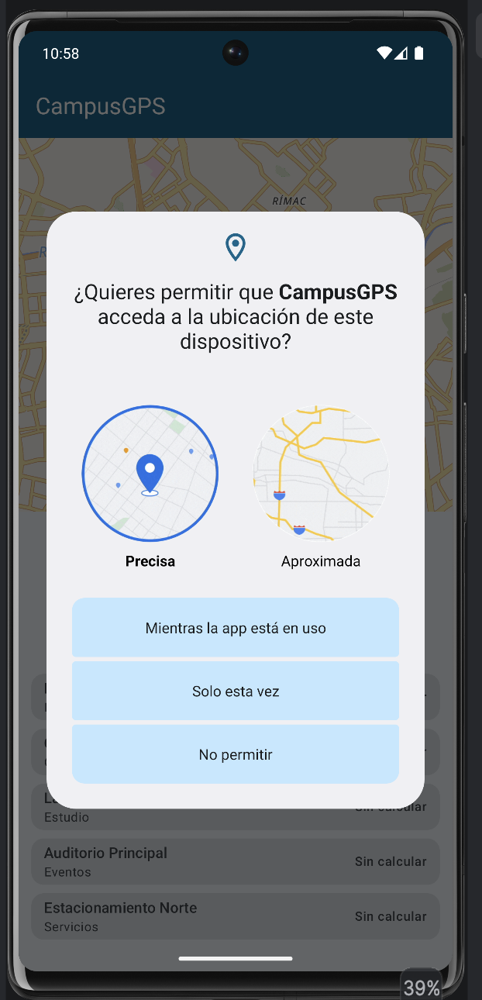
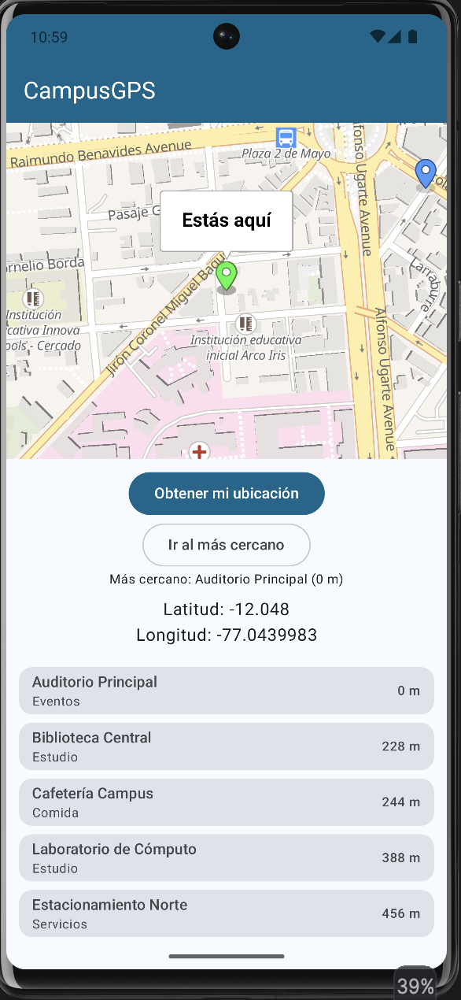
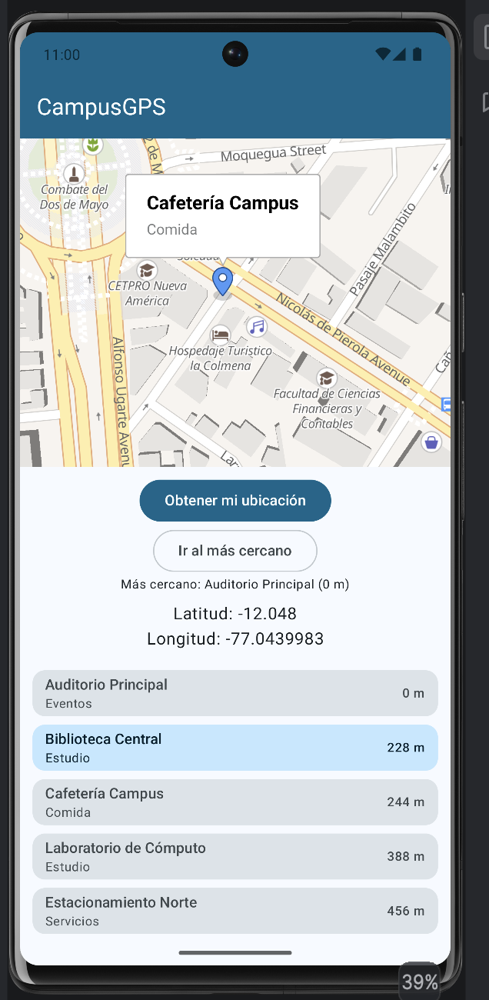
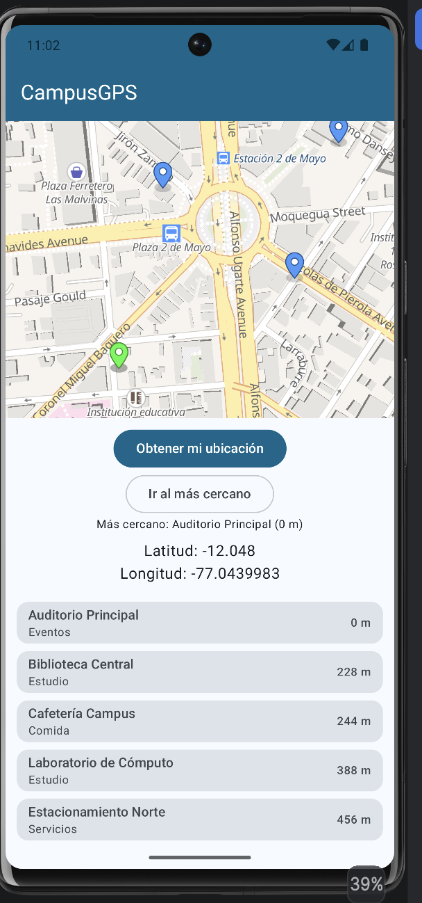
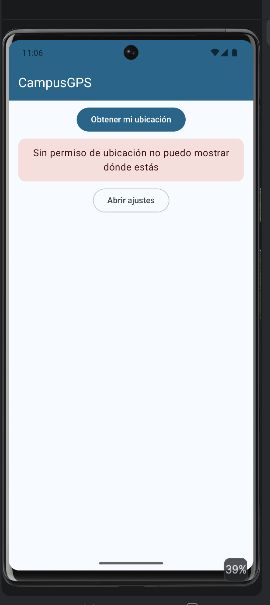

# CampusGPS_Huanco

CampusGPS es una aplicación Android del Laboratorio 13 que consulta mi ubicación, muestra cinco lugares ficticios del campus en Lima y los ordena del más cercano al más lejano. Al tocar un lugar en la lista o pulsar «Ir al más cercano», la cámara del mapa se mueve hasta ese punto.

La interfaz está hecha con Jetpack Compose. Uso Fused Location Provider para obtener la ubicación del dispositivo y MapLibre con OpenFreeMap para mostrar el mapa.

## Estructura del proyecto

```text
app/src/main/java/com/huanco/campusgps/
├── MainActivity.kt
├── data/
│   ├── LugaresRepository.kt
│   ├── LugaresRepositoryLocal.kt
│   ├── UbicacionRepository.kt
│   └── UbicacionRepositoryGoogle.kt
├── model/
│   └── Modelos.kt
├── ui/
│   ├── ListaLugares.kt
│   ├── MapaUbicacion.kt
│   ├── MensajeError.kt
│   ├── PantallaMapa.kt
│   └── theme/
│       ├── Color.kt
│       ├── Theme.kt
│       └── Type.kt
├── util/
│   ├── Distancia.kt
│   └── Formato.kt
└── viewmodel/
    ├── CampusViewModelFactory.kt
    └── MapaViewModel.kt
```

## Diagrama MVVM

```text
Pantalla → MapaViewModel → Repositorios de ubicación y lugares
Pantalla ← Estado de la pantalla ← MapaViewModel
```

## Capturas

1. Solicitud del permiso de ubicación al pulsar «Obtener mi ubicación».


2. Mapa con el marcador «Estás aquí», latitud y longitud.


3. Marcadores del campus con el nombre y la categoría de un lugar seleccionado.


4. Lista de lugares ordenados por distancia, con el más cercano identificado.


5. Estado de error por permiso denegado con el botón «Abrir ajustes».



## Para pensar

**1. ¿Por qué FusedLocationProviderClient está dentro del Repository y no en el ViewModel?**

Lo uso en `UbicacionRepositoryGoogle` porque ahí obtengo la posición con los servicios de Android. El ViewModel pide la ubicación mediante la interfaz `UbicacionRepository` y usa el resultado para actualizar la pantalla.

**2. ¿Qué diferencia hay entre el permiso de ubicación y la clave de API de Maps? ¿Qué pasa si falta cada uno?**

El permiso permite que la app lea mi ubicación. Si lo niego, no puede mostrar mi posición ni calcular las distancias desde ella. La clave identifica y autoriza la app ante Google Maps, si falta o no es válida, Google Maps no puede cargar el mapa correctamente. En esta versión uso MapLibre con OpenFreeMap, por lo que el mapa no necesita una clave de Google Maps.

**3. ¿Por qué la clave va en local.properties y no en el código? ¿Qué harías si se subiera a GitHub por error?**

La guardaría en `local.properties` porque Git ignora ese archivo y Gradle puede leerlo en mi equipo. Si se publicara por error, revocaría la clave expuesta, retiraría su valor del repositorio y crearía otra con las restricciones de la app.

**4. ¿Dónde calculas la distancia y por qué no en el Composable?**

Calculo los metros en `util/Distancia.kt` con `Location.distanceBetween`. Cuando llega una ubicación, `MapaViewModel` calcula las distancias, ordena la lista y entrega el resultado a Compose, que se encarga de mostrarlo.

**5. ¿Qué pasa con tu app si el usuario niega el permiso dos veces? ¿Cómo lo manejas?**

Android puede dejar de mostrar la solicitud después de varias negativas. Mi app sigue abierta, muestra un aviso y ofrece «Abrir ajustes» para que el usuario pueda conceder el permiso desde la configuración de CampusGPS.
